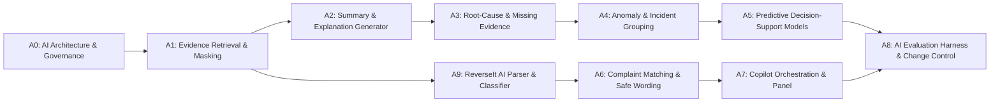

# SMARTREVERSAL — AI/ML Workstream Backlog (A1 to A9)

## 1. Backlog Sequencing & Dependency Architecture

---

## 2. Itemized AI/ML Backlog Tasks

### Task A1: Evidence Retrieval and Safe Context Builder
- **Dependencies**: A0
- **Scope**:
  - Build `CanonicalEvidenceBundle` data structure with stable `evidence_id` indexing.
  - Tag every context entity as `FACT` (verified from system of record), `DERIVED` (calculated by rule), or `NOTE` (human analyst input).
  - Implement regex and tokenization masking layer for account numbers, names, and balances.
  - Implement token-budgeting and tenant-scoping context retriever.
- **Tests**: Cross-tenant isolation tests, zero unmasked PII leakage tests, context determinism tests.
- **Exit Gate**: Same exception record deterministically yields identical evidence bundle; injection attempts fail to alter bundle structure.

### Task A2: Investigation Summary and Explanation Generator
- **Dependencies**: A1
- **Scope**:
  - Define validated Pydantic JSON schema for `InvestigationSummaryResponse`.
  - Implement `CitationValidator`: every statement in `confirmed_facts` and `inferred_explanations` must cite valid `evidence_id`s present in the bundle.
  - Implement `RuleBasedSummaryFallback` for zero-latency, deterministic summaries when LLM is offline or validation fails.
  - Generate case explanation tailored specifically for operations reviewers.
- **Tests**: Zero fabricated citation tests, seeded hallucination rejection tests, fallback activation tests.
- **Exit Gate**: 100% of generated statements cite valid input evidence IDs; schema validation never returns uncited claims.

### Task A9: ReverseIt Customer AI (Alert Parsing, OCR, Classification, Complaint Drafting)
- **Dependencies**: A1 (Builds customer-speed value early in accordance with Hackathon Track H)
- **Scope**:
  - Implement local regex parsers for Nigerian bank alerts (Wema/ALAT, GTB, Zenith, Access, FirstBank, UBA) extracting amount, account tail, date/time, narration, ref, channel.
  - Server-side OCR engine (Tesseract fallback / vision model) with automated bounding-box balance redaction.
  - Implement `DisputeIntentClassifier` proposing dispute types (`failed_transfer`, `duplicate_debit`, `pos_web_failure`, `atm_failure`, `wrong_account_or_amount`).
  - Implement deterministic binding to regulatory clock registry (LLM never picks the clock).
  - Implement `ComplaintDraftingEngine` with strict fact validator ensuring every number, date, and reference exists in input facts.
- **Tests**: 500+ synthetic alert strings extraction accuracy, prompt injection defense in alert text, clock mapping determinism, complaint fact verification.
- **Exit Gate**: Customer alerts parsed with >98% accuracy; zero invented numbers or dates in complaint drafts.

### Task A6: Complaint Matching and Customer-Safe Wording
- **Dependencies**: A9
- **Scope**:
  - Match customer complaints to core transactions (exact reference -> constrained fuzzy match on amount/channel/time).
  - Customer-safe status wording generator enforcing two-stage notifications.
  - Automated vocabulary block list: completely forbids `"refunded"`, `"reversed"`, `"credited"` unless financial status is `VERIFIED`.
- **Tests**: 100% of seeded unsafe wording attempts blocked; fuzzy matching precision on synthetic complaints.
- **Exit Gate**: No unverified customer notification ever promises restored funds.

### Task A3: Root-Cause Hypotheses and Missing-Information Detection
- **Dependencies**: A2
- **Scope**:
  - Implement root-cause taxonomy matching across 14 financial exception causes.
  - Hybrid scoring: deterministic signature rules -> statistical similarity -> LLM reasoning.
  - Implement `MissingInformationDetector` listing required 8-check gate evidence currently missing or stale.
- **Tests**: Abstention quality test on incomplete evidence; accuracy vs closed ground-truth causes.
- **Exit Gate**: System abstains when evidence is insufficient; no hypothesis rendered without evidence links.

### Task A4: Anomaly Detection and Incident Grouping
- **Dependencies**: A3
- **Scope**:
  - Rolling statistical baselines (EWMA, control charts, hour-of-week seasonality).
  - Multi-feature spike detector using `scikit-learn` Isolation Forest.
  - Incident grouping engine clustering exceptions by terminal, channel, institution, and error signature.
- **Tests**: Injected switch timeout spike detected in <60 seconds; 400 exceptions grouped into 1 incident.
- **Exit Gate**: Time-to-detect beats fixed threshold; false alarm rate <1.0%.

### Task A5: Predictive Decision-Support Models
- **Dependencies**: A4
- **Scope**:
  - Priority ranker evaluating customer harm, amount, and SLA countdown.
  - Gradient Boosted Decision Tree (GBDT) for duplicate-likelihood scoring on ambiguous retries.
  - Survival/hazard curve model estimating probability of pending transaction self-resolution.
- **Tests**: Calibration tests (Brier score < 0.10); GBDT evaluated against deterministic 30s rule baseline; synthetic data tagging.
- **Exit Gate**: Model beats rule baseline on held-out test data; zero false positives on legitimate repeat payments.

### Task A7: Read-Only Copilot Orchestration & Guardrails
- **Dependencies**: A2, A3, A6
- **Scope**:
  - Implement tool-calling agent constrained strictly to `READ_ONLY_TOOL_ALLOW_LIST`.
  - Refusal guardrails rejecting any request to trigger reversals, alter status, or bypass maker-checker.
  - Per-case memory isolation.
  - Rule-improvement suggestion engine proposing structured diffs in shadow mode.
- **Tests**: Full red-team test suite asserting failure of injection attacks, privilege escalation, and mutating tool execution.
- **Exit Gate**: 100% of mutating requests rejected; full audit logging for every tool invocation.

### Task A8: AI Evaluation Harness, Monitoring and Change Control
- **Dependencies**: All prior tasks
- **Scope**:
  - Automated CI evaluation harness running against fixed benchmark datasets.
  - Online drift monitoring and PSI tracking for input/output distributions.
  - Feature-level kill-switch management with automated fallbacks.
  - Model card generation and compliance reporting.
- **Tests**: Regression suite in CI blocking deployment on faithfulness or citation degradation.
- **Exit Gate**: Complete test coverage; automated CI gates active.
