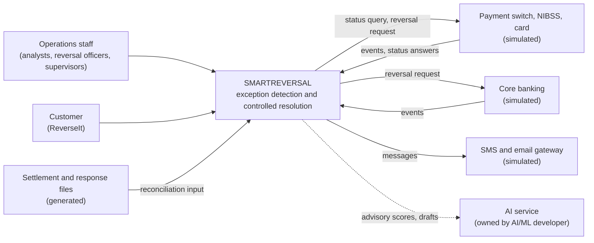
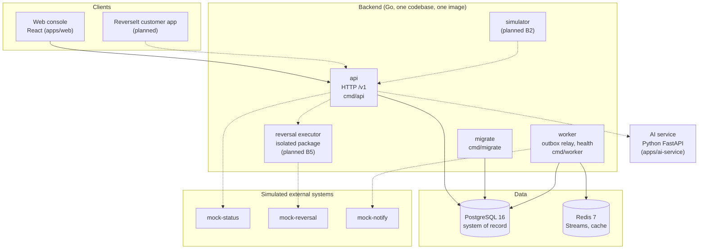
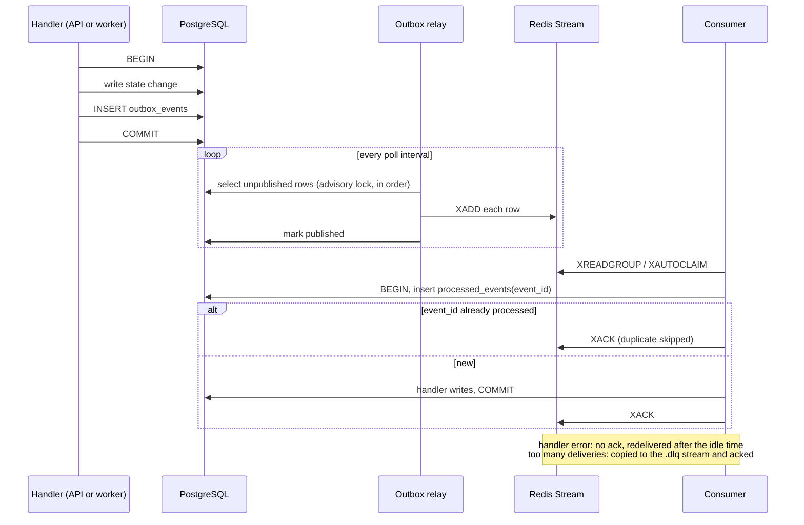

# C4 Diagrams

Status: B0. Shows what exists after B0 and what the playbooks plan. Dashed elements are planned, not built. Everything outside the SMARTREVERSAL boundary is simulated in Track H.

## Level 1: System context

SMARTREVERSAL never reads a core banking database directly. It uses APIs, event feeds and files only.

## Level 2: Containers

Rules shown here:

- Only the reversal executor may call the reversal provider.
- The API and worker never call the AI service from the reversal path.
- PostgreSQL holds every authoritative fact. Redis carries events and can be rebuilt from the outbox.

## Event flow (D2)

Delivery is at least once. A crash between `XADD` and marking the row published sends the event twice, and `processed_events` makes the second delivery harmless. If Redis loses a stream, `outbox.Requeue` marks rows unpublished and the relay sends them again.
